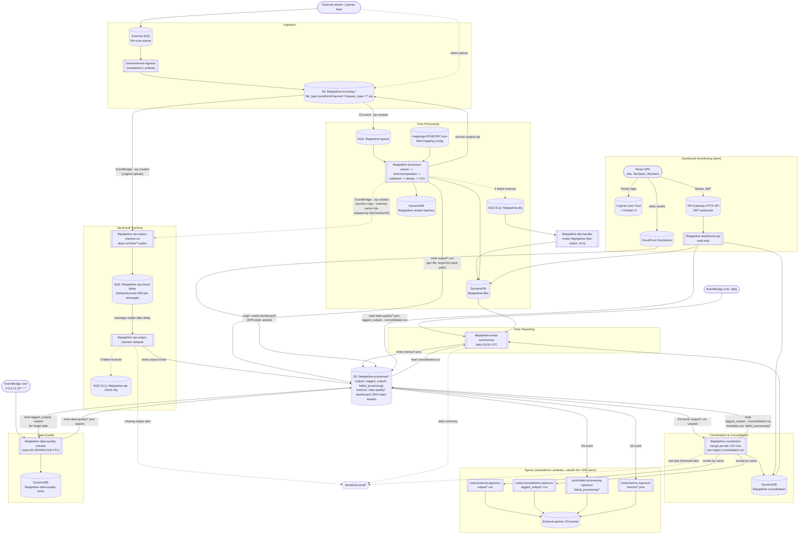
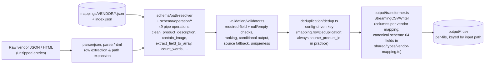

# FilePipeline — Project Architecture

Generated from a full-codebase review (`packages/infra/lib/filepipeline-stack.ts`, `packages/lambda/src/*`, `packages/shared/src/*`, `tools/*`, `impldocs/*`) on 2026-07-15. All AWS resources are deployed to `ap-southeast-1` in a single CDK stack (`FilePipelineStack`).

## 1. End-to-end system architecture

## 2. Processor internal pipeline (per-file transform)

## 3. Component reference

| Lambda                                    | Trigger                                                                                                                                          | Reads                                                                                                           | Writes                                                                                                                        | Memory / Timeout |
| ----------------------------------------- | ------------------------------------------------------------------------------------------------------------------------------------------------ | --------------------------------------------------------------------------------------------------------------- | ----------------------------------------------------------------------------------------------------------------------------- | ---------------- |
| `filepipeline-processor`                  | SQS `filepipeline-queue` (from S3 `.zip` create on incoming bucket)                                                                              | incoming bucket, `mappings/*.json`, `filepipeline-files`, `filepipeline-vendor-batches`                         | `output/*.csv`, archived zip, `filepipeline-files`/`vendor-batches` status                                                    | 2560 MB / 5 min  |
| `filepipeline-dlq-handler`                | SQS `filepipeline-dlq` (batch size 10, i.e. whenever SQS itself moves a message off `filepipeline-queue` after 2 failed receives)                | `filepipeline-files` (by S3 key)                                                                                | `filepipeline-files`: sets `status: "DLQ"` on the matching record, or creates one if none exists yet                          | 256 MB / 30 sec  |
| `filepipeline-coordinator`                | S3 event: `output/*.csv` created                                                                                                                 | `filepipeline-consolidation`, prior `tagged_output/.../consolidated.csv`                                        | `tagged_output/.../consolidated.csv`, `metadata.csv`, `failed_processing/*`; invokes external/consolidation egressors by name | 3584 MB / 5 min  |
| `filepipeline-zip-output-checker-s3`      | EventBridge: `.zip` created on incoming bucket                                                                                                   | —                                                                                                               | `filepipeline-zip-check-delay` (SQS, DelaySeconds=300)                                                                        | 256 MB / 30 sec  |
| `filepipeline-zip-output-checker-delayed` | SQS `filepipeline-zip-check-delay` (one message per ZIP, visible 5 min after send)                                                               | processed bucket                                                                                                | SendGrid alert on missing output                                                                                              | 256 MB / 30 sec  |
| `filepipeline-data-quality-checker`       | EventBridge cron every 6h (`00/06/12/18 UTC`) — code also supports an SQS event shape, but no queue resource is currently wired in the CDK stack | `tagged_output/`, `output/` CSVs for target date                                                                | `filepipeline-data-quality-locks`; `data-quality/*.json` reports                                                              | 1536 MB / 5 min  |
| `filepipeline-email-summariser`           | EventBridge cron, daily `00:00 UTC`                                                                                                              | `filepipeline-files`, `filepipeline-consolidation`, `tagged_output/.../consolidated.csv`                        | `metrics/*.json`; SendGrid daily summary email                                                                                | 512 MB / 30 sec  |
| `filepipeline-dashboard-api`              | API Gateway HTTP API (JWT-authorized, GET only)                                                                                                  | `data-quality/*.json`, `tagged_output/.../consolidated.csv`, `filepipeline-files`, `filepipeline-consolidation` | — (read-only)                                                                                                                 | 512 MB / 60 sec  |

**DynamoDB tables**: `filepipeline-files` (per-file record + GSIs `vendor-status-index`, `status-createdAt-index`, `s3Key-index`), `filepipeline-vendor-batches`, `filepipeline-consolidation`, `filepipeline-data-quality-locks`. All PAY_PER_REQUEST with `RemovalPolicy.DESTROY` (single non-prod-hardened environment).

**SQS queues**: `filepipeline-queue`/`filepipeline-dlq` (main processing — `filepipeline-dlq` is consumed by `filepipeline-dlq-handler`, batch size 10), `filepipeline-zip-check-delay`/`filepipeline-zip-check-dlq` (zip-output-checker's one-shot delayed check, `maxReceiveCount: 2` — this DLQ has no consumer).

**S3 buckets**: `filepipeline-incoming-{account}-{region}` (raw zip/json/html uploads), `filepipeline-processed-{account}-{region}` (all processing outputs under `output/`, `tagged_output/`, `failed_processing/`, `metrics/`, `data-quality/`).

**Dashboard hosting**: the React SPA (`packages/frontend/dashboard`) is built and deployed as static assets into the **same processed bucket**, under the **`dashboard/`** prefix. `DashboardDistribution` (CloudFront) uses that bucket/prefix as its origin (via an Origin Access Identity), with SPA-style 403/404 fallback to `dashboard/index.html`. The SPA itself talks to a separate API Gateway HTTP API (JWT-authorized) backed by `filepipeline-dashboard-api` for data — CloudFront only serves the built JS/CSS/HTML bundle, not API traffic.

**Dashboard auth config**: the Cognito User Pool Client's Hosted UI callback/logout URLs and the dashboard API's CORS allow-list are deploy-time configurable via `DASHBOARD_AUTH_CALLBACK_URLS`, `DASHBOARD_AUTH_LOGOUT_URLS`, and `DASHBOARD_API_ALLOWED_ORIGINS` (comma-separated; default to `localhost:5173` plus the CloudFront URL). An initial Cognito user can optionally be seeded at deploy time via `DASHBOARD_SEED_USER_EMAIL`/`DASHBOARD_SEED_USER_PASSWORD` (left blank to skip).

## 4. Standalone tools (outside the CDK stack)

The `tools/` egressor family (`external-egressor`, `consolidation-egressor`, `failed-processing-egressor`, `metrics-egressor`) and `external-ingestor` are each deployed independently (own `deployment.sh`), not part of `FilePipelineStack`. They follow one shared pattern: S3-event-triggered copy between the internal processed bucket and an external partner bucket, one Lambda per output prefix.

| Tool                               | Direction                           | Prefix watched                                           | Purpose                                 |
| ---------------------------------- | ----------------------------------- | -------------------------------------------------------- | --------------------------------------- |
| `tools/external-ingestor`          | external → `filepipeline-incoming`  | — (SQS `<external-file-scan-queue>`)                     | Cross-account ingress into the pipeline |
| `tools/external-egressor`          | `filepipeline-processed` → external | `output/`                                                | Egress per-file CSVs                    |
| `tools/consolidation-egressor`     | `filepipeline-processed` → external | `tagged_output/*.csv` (no filename filter beyond `.csv`) | Egress consolidated CSVs                |
| `tools/failed-processing-egressor` | `filepipeline-processed` → external | `failed_processing/`                                     | Egress validation-failure artifacts     |
| `tools/metrics-egressor`           | `filepipeline-processed` → external | `metrics/`                                               | Egress run telemetry                    |

Local/dev-only, no AWS runtime role: `tools/parser` (CLI reusing the production mapping engine to preview vendor JSON → CSV/XLSX locally), `tools/csv-to-excel`, `tools/ranking-calculator` (Python), `tools/bullet-points` (Python prototypes later ported into `packages/shared`), `tools/s3manager` and `tools/local-zip-testing` (LocalStack-only E2E helpers).

## 5. Secrets management

`SENDGRID_API_KEY` (used by `filepipeline-coordinator`, `filepipeline-email-summariser`, and `filepipeline-zip-output-checker-delayed` to send alert/summary emails) is **not** stored in any file in this repo. It lives in **AWS Secrets Manager** (`ap-southeast-1`, secret id `filepipeline/sendgrid-api-key`) and is only ever touched at deploy time:

- **Create/rotate**: `bun run create:aws:sendgrid-secret <key>` (`scripts/create-sendgrid-secret.ts`) — creates the secret if absent, or overwrites its value (`ResourceExistsException` → `PutSecretValueCommand`) if it already exists. Requires the `filepipeline` AWS profile identity to succeed (falls back to refreshing it from `.env.prod`, per `.claude/rules/deploy-safety.md`).
- **Deploy-time injection**: `bun run deploy:aws` (`scripts/deploy.ts`) fetches the secret once via `@aws-sdk/client-secrets-manager`, holds it only in the running script's memory, and:
  - sets it in `process.env.SENDGRID_API_KEY` before `cdk deploy`, which `filepipeline-stack.ts` reads into the **coordinator** Lambda's `environment` block at synth time;
  - after `cdk deploy` completes, calls `@aws-sdk/client-lambda`'s `UpdateFunctionConfigurationCommand` directly to merge the key into **`filepipeline-email-summariser`** and **`filepipeline-zip-output-checker-delayed`** — CDK doesn't manage this env var for those two, since they aren't wired to read `process.env.SENDGRID_API_KEY` in the stack definition. (`filepipeline-zip-output-checker-s3` never gets the key — it doesn't send email.)
- The Lambdas themselves are unchanged: they still just read `process.env.SENDGRID_API_KEY` like any other env var. Only the deploy tooling changed — no Lambda code calls Secrets Manager at runtime.
- **If the secret is missing, empty, or unreadable** (e.g. missing `secretsmanager:GetSecretValue` IAM permission), **the deploy fails immediately** (`fetchSendGridApiKey()` calls `process.exit(1)`) — this check runs before any build/bootstrap/CDK-deploy step, so nothing gets deployed at all. This is intentional: `email-summariser` and `zip-output-checker-delayed` both hard-`throw` at runtime if `SENDGRID_API_KEY` is unset (see their handlers), so a deploy that silently omitted the key would produce Lambdas that fail on every invocation instead of failing loudly at deploy time.
- This only relocates the key off local disk/git; it does **not** change how the key is stored on the AWS side — it still ends up as a plaintext Lambda environment variable (KMS-encrypted at rest, same as any Lambda env var), visible to anyone with `lambda:GetFunctionConfiguration` on that function.

**Note**: as of 2026-07-30, three separate bugs were found and fixed in `packages/lambda/src/zip-output-checker/index.ts` through live LocalStack testing (not just code review) — the key-parsing regex assumed an old S3 key convention, the DynamoDB scheduled-check query used an invalid key condition on a GSI partition key, and its `S3Client` was missing the `endpoint`/`forcePathStyle` override needed to reach LocalStack locally (a local-testing-only issue — no effect in production, since `AWS_ENDPOINT_URL` is never set there).

**Note**: as of 2026-08-17, the feature was redesigned to remove the `rate(2 min)` polling schedule and its `filepipeline-zip-checks` DynamoDB table (including an unusable `checkAfter-index` GSI — a range condition on a GSI partition key isn't a valid DynamoDB query, so the old scheduled handler fell back to a full table `Scan` every run; this had already caused a real S3-cost incident on 2026-08-16 when resolved records were never cleaned up, growing the backlog scanned on every 2-minute tick). The check now runs exactly once per ZIP via an SQS delay queue (`filepipeline-zip-check-delay`, `DelaySeconds=300` per message) instead of a shared poll.

**Note**: the SQS redesign above exposed a second, previously-dormant bug — the `ZipOutputCheckerS3EventRule` matches any `.zip`-suffixed "Object Created" event on the incoming bucket, and the processor's own archive copy (`moveObject` in `packages/lambda/src/processor/index.ts`, copying the source ZIP to `archive/...`) is itself such an event. Under the old DynamoDB design this was harmless — both invocations wrote the same `pk`/`sk` item, so the second write silently overwrote the first. Under the SQS design each invocation independently enqueues its own message, so every ZIP briefly caused two delayed checks and, when the CSV was missing, two duplicate alert emails (confirmed live via a production replay on 2026-08-17). Fixed the same day by having `handleS3ZipArrival` skip any key for which `isArchivedIncomingKey()` (`packages/lambda/utils/s3.ts`) returns true.

## 6. Notes

- Single CDK stack, single environment — no stage/prod parameterization; all resources use `RemovalPolicy.DESTROY`.
- The egressor Lambdas (`external-egressor`, `consolidation-egressor`) are referenced by name/ARN from `filepipeline-coordinator`'s IAM policy but are **not defined in `FilePipelineStack`** — they live in a separate deployment (see `tools/*/deployment.sh`).
- The dashboard SPA and the processing pipeline's CSV/report outputs share one bucket (`filepipeline-processed-*`) but live under disjoint prefixes (`dashboard/` vs. `output/`, `tagged_output/`, `metrics/`, `data-quality/`, `failed_processing/`) — CloudFront is scoped to `dashboard/` only.
- Output/archive S3 keys (`buildConsolidatedOutputKey()`/`buildArchiveKeyFromIncomingKey()` in `packages/lambda/utils/s3.ts`) are derived only from the input path and filename. Re-uploading the same S3 key reuses the same `FileRecord.id` (reset to `QUEUED`, per `packages/lambda/src/processor/index.ts` around lines 952-1009) and **overwrites** the prior output CSV and archived ZIP in place. See `impldocs/PerFileConsolidationAndReupload.md` for the full file-record lifecycle and key-derivation details.
- The data-quality-checker is triggered directly by an EventBridge cron schedule (`00/06/12/18 UTC`) — no SQS queue is involved. The handler code contains an SQS-event-handling branch (see `impldocs/DataQualityCheckerArchitecture.md`), but since no queue delivers events to it, that branch never runs. Its DynamoDB date-lock (`DQ#YYYY-MM-DD`) is only acquired inside that branch, so the real EventBridge-triggered runs are not lock-protected against concurrent execution for the same date.
- The DLQ (`filepipeline-dlq`) has an automated consumer as of 2026-09-16, `filepipeline-dlq-handler` (`packages/lambda/src/dlq-handler/index.ts`), which marks the matching `filepipeline-files` record `status: "DLQ"` (creating one if none exists yet) whenever SQS itself moves a message to the DLQ after 2 failed receives. This exists specifically to cover the case a hard Lambda execution timeout kills `filepipeline-processor` mid-invocation, before its own in-process `markFileForDLQ` bookkeeping gets a chance to run — such a file previously vanished from the `zipFilesFailed` dashboard metric entirely rather than surfacing as `DLQ`. There is still no CloudWatch alarm and no redrive tooling (no `StartMessageMoveTask`/redrive script in this repo) — recovery still requires manually re-uploading the source file to the same S3 key. `filepipeline-zip-check-dlq` (the separate zip-output-checker DLQ) still has no consumer at all.
- The post-processing archive step (`moveObject` copying the incoming ZIP to `archive/...`, in `packages/lambda/src/processor/index.ts`) can fail silently: the error is only logged via `console.warn`, never re-thrown, so the SQS message is still treated as successfully processed. This means a file's `filepipeline-files` record can show `status: "COMPLETED"` even though the source ZIP was never actually archived and remains sitting in `incoming/` — there is no DynamoDB field or alarm that surfaces this discrepancy.
- `SENDGRID_API_KEY` moved from plaintext `.env` files (previously committed to git) to AWS Secrets Manager as of 2026-07-17 — see section 5.
- `filepipeline-coordinator`'s IAM role is still granted read/write on `filepipeline-files` (`filepipeline-stack.ts`) and the table name is passed in via env var, but `packages/lambda/src/coordinator/index.ts` never actually reads or writes it — this is a dead permission grant, not an active data dependency.
- `metrics/*.json` (written daily by `filepipeline-email-summariser`) currently has no reader anywhere in the codebase — `filepipeline-dashboard-api` reads `data-quality/*.json` and live `tagged_output/.../consolidated.csv` instead.
- **2026-08-24 doc audit**: cross-checked this document against current source and corrected several drifts that had accumulated since the 2026-07-15 review: the pipe-operation count (48 → 49), the canonical output schema's location and size (was attributed to `output/transformer.ts` at 59 columns; it's actually the `OutputColumns` type in `packages/shared/src/types/vendor-mapping.ts`, now 64 fields — that type's own code comment is also stale at "59 fields"), the dedup key description (config-driven via `mapping.rowDeduplication`, not a hardcoded `source_product_id`/`sku` field), the validator's scope (expanded well beyond required/null-empty checks to ranking, conditional output, source fallback, and uniqueness), `filepipeline-dashboard-api`'s actual reads (see above), the two dead/unused items noted above, processor output keys (keyed only by input path, with no per-run suffix — consistent with the re-upload/overwrite behavior already described above), and `consolidation-egressor`'s real prefix filter (`tagged_output/*.csv`, with no check for the "consolidated" substring).
- **2026-09-17 doc audit**: cross-checked this document against commits made since the 2026-09-14 handover package (`feat: dlq handler`, `chore: update tiktok schema`, `chore: standardize date formats across`) and corrected drift: added `filepipeline-dlq-handler` (see above — the "no automated consumer" DLQ note was stale). Also note the three independent filename-date-extraction implementations previously in `packages/lambda/src/processor/index.ts`, `packages/lambda/src/coordinator/date-utils.ts`, and `packages/lambda/utils/s3.ts` (each hand-rolled, and already at risk of drifting apart — the coordinator's copy had in fact fallen behind, supporting only 2 of 3 date formats and silently dropping matching files from the consolidated CSV) were consolidated into one canonical `extractDateFromFilename` in `packages/shared/src/utility/date-extraction.ts`, which all three now delegate to. The Tiktok mapping/schema-cutover changes from the same period are covered in `impldocs/PathExtractionAndPerFileMapping.md`'s 2026-09-16 changelog entry, not repeated here.
