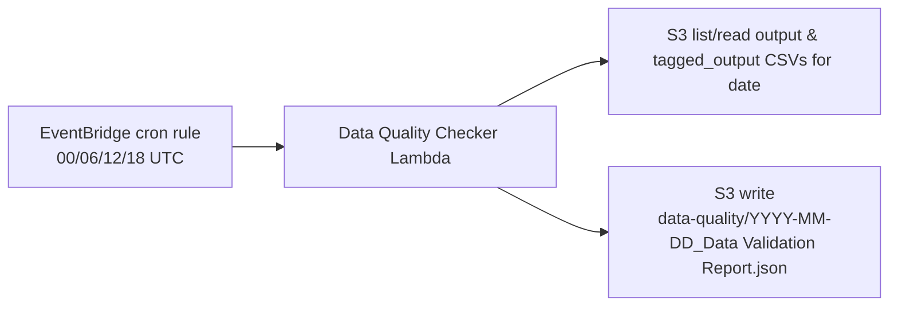

# Data Quality Checker Architecture

**Date**: June 3, 2026 (Updated: June 29, 2026)  
**Status**: Completed  
**Project**: FilePipeline

---

## Summary

This document describes the current production architecture for `filepipeline-data-quality-checker`, including trigger sources, locking, report generation, and operational behavior.

At a high level:

1. Data-quality execution is **scheduled via EventBridge** to run every 6 hours (00:00, 06:00, 12:00, 18:00 UTC).
2. Runs are date-scoped. A DynamoDB lock (`DQ#YYYY-MM-DD`) exists in code, but as documented in the Concurrency section below, the current EventBridge-scheduled production path does **not** acquire it.
3. The checker reads all relevant CSVs for the date and writes one JSON report:
   `data-quality/YYYY-MM-DD_Data Validation Report.json`.

**Note**: Prior to June 29, 2026, the data-quality-checker was triggered by S3 object creation events routed through SQS. This event-driven approach was replaced with scheduled execution to reduce Lambda invocation costs and eliminate cascading replay-triggered invocations.

---

## Problem and Goals

### Problem (Resolved June 29, 2026)

**Previous**: Event-driven S3 triggers caused cascade amplification during replay operations. A single replay of 110 ZIP files produced 12,959 Lambda invocations (9,289 data-quality-checker invocations), resulting in excessive data transfer costs (~$10-11 in egress charges).

**Root causes**:

1. S3 event notification on `tagged_output/*/consolidated.csv` triggered data-quality-checker for every file consolidation.
2. Coordinator Lambda forwarded SQS messages to data-quality-queue for every consolidated CSV.
3. Combined effect: event-driven triggers scaled linearly with input file count during replays.

### Goals

1. **Cost optimization**: Schedule data-quality execution at fixed intervals instead of event-driven scaling.
2. **Replay isolation**: Prevent replay activity from triggering additional Lambda cascades.
3. **Deterministic execution**: Single daily run (4x per day) regardless of CSV arrival patterns.
4. **Date-scoped locking**: Avoid concurrent writes for the same date.
5. **Stable reporting**: Produce a consistent JSON contract consumed by dashboard/API.

---

## Architecture Components

### AWS Resources

1. `filepipeline-processed-<account>-ap-southeast-1` (S3)
2. `filepipeline-data-quality-locks` (DynamoDB)
3. `filepipeline-data-quality-checker` (Lambda)

The CDK stack (`packages/infra/lib/filepipeline-stack.ts`) provisions four SQS queues in total — `ProcessorDLQ`/`ProcessingQueue` (wired to the main processor Lambda via `SqsEventSource`) and `ZipCheckDelayDLQ`/`ZipCheckDelayQueue` (wired to the zip-output-checker delayed Lambda, unrelated to data quality). There is no `filepipeline-data-quality-queue` or data-quality DLQ provisioned today, and `filepipeline-data-quality-checker` has no `addEventSource`/`SqsEventSource` wiring. Its only trigger is `dataQualityCheckerSchedule.addTarget(new targets.LambdaFunction(dataQualityCheckerLambda))`, an EventBridge cron rule. `packages/lambda/src/coordinator/index.ts` has zero references to data-quality forwarding.

### Lambda Configuration

`filepipeline-data-quality-checker` env vars, as actually defined in `filepipeline-stack.ts` (~lines 335-338):

1. `PROCESSED_BUCKET`
2. `DATA_QUALITY_LOCK_TABLE`
3. `DATA_QUALITY_RETRY_DELAY_SECONDS` (default `180`)
4. `DATA_QUALITY_LOCK_TTL_SECONDS` (default `600`)

**Note on `DATA_QUALITY_QUEUE_URL`**: this env var is not set in the CDK stack's Lambda environment, so it is unset in production. The handler (`packages/lambda/src/data-quality-checker/index.ts`) and the local runner (`packages/lambda/src/local-data-quality-runner.ts`) still read `process.env.DATA_QUALITY_QUEUE_URL` to support a local-only SQS-event code path used for local/dev testing. In production this path is never exercised, since nothing populates the variable or delivers SQS events to this Lambda.

---

## Trigger Topology

### Current: EventBridge cron -> Lambda (direct)

`dataQualityCheckerSchedule` is an EventBridge `events.Rule` running on a fixed cron schedule (`00/06/12/18 UTC`), targeting `filepipeline-data-quality-checker` directly via `addTarget(new targets.LambdaFunction(dataQualityCheckerLambda))`. There is no queue, DLQ, or coordinator involved in this path. On each firing:

1. The Lambda receives an EventBridge `ScheduledEvent` (not an SQS event).
2. It resolves the target date via `resolveTargetDate(event)` (defaulting to the current UTC date, or an override date if provided in the event).
3. It calls `runDataQualityForDate(targetDate)` directly.
4. It scans the processed bucket for `output/`/`tagged_output/` CSVs matching that date, computes feature1/feature2 checks, and writes the report JSON.

No SQS queue or DLQ exists for data quality in the CDK stack — `packages/infra/lib/filepipeline-stack.ts` provisions `ProcessorDLQ`/`ProcessingQueue` for the main processor and `ZipCheckDelayDLQ`/`ZipCheckDelayQueue` for the zip-output-checker, with none of these wired to data-quality. The coordinator Lambda (`packages/lambda/src/coordinator/index.ts`) has no data-quality-forwarding logic. The data-quality-checker handler still contains an SQS-event-handling branch (see below), but nothing in production ever delivers an SQS event to this Lambda, so that branch never runs.

---

## End-to-End Flow



Execution behavior (current, EventBridge-triggered path):

1. Lambda receives a `ScheduledEvent`, not an SQS event.
2. Checker resolves the target date via `resolveTargetDate(event)`.
3. Checker scans S3 for all matching CSV inputs for that date.
4. Checker computes feature1/feature2 checks.
5. Checker writes report JSON.
6. No DynamoDB lock is acquired on this path — see Concurrency section below.

The lock-acquisition / SQS-message-parsing flow described in earlier versions of this doc (parse message body for S3 keys, acquire per-date lock, delay message visibility on contention) still exists in the handler's `isSqsEvent(event)` branch, but that branch is unreachable in production since no SQS event source is wired to this Lambda.

---

## Input Discovery Rules

For target date `YYYY-MM-DD`:

### Feature1 inputs

1. `tagged_output/.../consolidated.csv` for the date
2. `output/.../*.csv` excluding:
   - `request_type=keyword-products`
   - `metrics_processed.csv`

Feature1 output groups:

1. `consolidated`
2. `shop-products`
3. `product-skus`

### Feature2 inputs

1. `output/.../request_type=keyword-products/...*.csv` for the date
2. Excludes `metrics_processed.csv`

---

## Report Contract

Output key:

1. `data-quality/YYYY-MM-DD_Data Validation Report.json`

Top-level JSON shape:

```json
{
  "feature1": {
    "consolidated": [],
    "shop-products": [],
    "product-skus": []
  },
  "feature2": []
}
```

Feature1 scripts:

1. OLA Data Quality
2. Rating & Reviews Data Quality
3. Price Competitiveness Quality

Feature2 scripts:

1. Share_of_Search_Ranking_Quality
2. Price Competitiveness Quality

---

## Concurrency and Retry Model

Lock key format (as implemented in code):

1. `pk = DQ#YYYY-MM-DD`

**Important limitation**: this lock is only acquired/released on the `isSqsEvent(event)` branch of `handler()` in `packages/lambda/src/data-quality-checker/index.ts` (around lines 1779-1798), via `acquireDateLock`/`releaseDateLock`. The actual production trigger — the EventBridge `ScheduledEvent` path — takes the `!isSqsEvent(event)` branch (lines 1750-1754), which calls `resolveTargetDate(event)` and `runDataQualityForDate(targetDate)` directly with **no lock acquisition at all**.

Because no SQS event source is wired to this Lambda in production (see Trigger Topology above), the lock-guarded branch is currently dead code in the real deployment. This means:

1. The lock mechanism exists and is correctly implemented, and would apply if an SQS-based trigger were reintroduced.
2. In production today, concurrent or overlapping EventBridge-scheduled invocations for the same date are **not** mutex-protected — there is no per-date single-writer guarantee at runtime.
3. This is a real current limitation, not just a documentation gap: if two scheduled runs for the same date overlap (e.g. a slow run plus the next 6-hour firing, or a manual invocation racing the schedule), both can read/compute/write the report for that date concurrently with no lock to serialize them.
4. The SQS-only mechanics described for that branch — `owner`/`lockUntil`/`updatedAt` lock contents, delaying message visibility via `ChangeMessageVisibility` on contention, and returning partial batch failures so locked/error dates are retried — remain accurate for that branch, but do not apply to the scheduled path that actually runs in production.

---

## Operational Runbook

## Replay a past date report

If processed CSVs already exist for that date:

1. Invoke checker with override date.
2. Verify the output JSON key for that date is rewritten.

If processed CSVs are missing:

1. Reprocess historical ZIPs first.
2. Then invoke checker for the date.

## Deployment safety

1. Avoid deployments during active scheduled run windows (00/06/12/18 UTC).
2. Verify the EventBridge rule -> Lambda target mapping is enabled after deploy.

---

## Current Known Trade-offs

1. A scheduled run can fire before all files for that date have fully arrived; the next scheduled run reruns and overwrites with a more complete report.
2. No SQS queue exists for data-quality today, so there is no coordinator-forwarding or queue-based invocation scaling concern in production.
3. Report freshness is schedule-driven (every 6 hours), not event-driven.
4. The date-scoped DynamoDB lock is not acquired on the production (EventBridge-scheduled) trigger path, so overlapping runs for the same date are not mutex-protected at runtime — see the Concurrency section above.

---

## Source References

1. `packages/infra/lib/filepipeline-stack.ts`
2. `packages/lambda/src/coordinator/index.ts`
3. `packages/lambda/src/data-quality-checker/index.ts`
4. `scripts/setup-localstack.ts`
